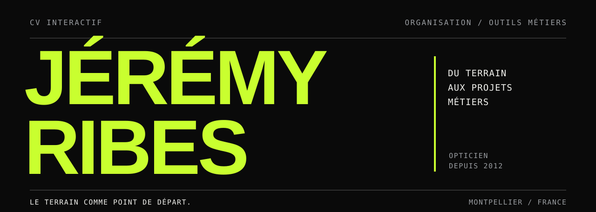

# Jérémy Ribes

**Coordination opérationnelle · Organisation et méthodes · Projets d'outils métiers**

Le parcours professionnel présenté ici s'est construit en magasin, puis s'est élargi à l'organisation des équipes, la conception d'outils métiers et le pilotage de projets numériques assistés par IA.

**[Consulter le CV interactif](https://j-rbs91.github.io/CV_interactif_Jeremy_Ribes/)** · **[CV synthétique A4, à imprimer ou enregistrer en PDF](https://j-rbs91.github.io/CV_interactif_Jeremy_Ribes/cv-a4.html)**

## Les réalisations

### Outils utilisés en magasin

Le **Suivi des devis et du tiers payant** rend visibles les dossiers, les échéances et les personnes responsables. **Brief'Maker** réunit planning, rendez-vous et tâches du jour. Le **Hub Outils Opticien** centralise les documents destinés aux médecins, les contrôles de caisse et les calculs optiques.

Ces trois outils sont utilisés quotidiennement par l'équipe, selon les observations rapportées.

[Découvrir le Hub Outils Opticien](https://j-rbs91.github.io/Hub_Tools_N_Templates/)

### Organisation et management

Ancien responsable de magasin chez Générale d'Optique : recrutement, formation, plannings, procédures et activité commerciale. Des méthodes d'atelier rédigées à Saint-Jean-de-Védas ont continué d'être utilisées après son départ, selon un témoignage direct rapporté.

**Les données de chiffre d'affaires et de marge propres aux employeurs ne sont pas publiées.**

### Projets numériques

**PANUM** prolonge un outil Google Sheets de suivi des devis vers une application web destinée à plusieurs magasins. Son efficacité dans le fonctionnement réel d'un point de vente reste à confirmer par un pilote.

[Découvrir PANUM](https://panum.fr/)

**ARCLINE, SECURIX, UXER et GUARDIAN** sont des projets personnels qui structurent le travail avec des agents IA : exécution et qualification de missions, contrôles de sécurité, recherche UX et protection ciblée des secrets.

D'autres projets, dont [L'Ortabels](https://app.ortabels.fr/) et Renta Menu, appliquent l'analyse et la modélisation à l'agriculture et à la restauration.

## Architecture actuelle

Le site public est une page statique, issue de la maquette éditoriale validée. Il conserve les styles `css/base.css` et `css/site.css`, le portrait et l'identité visuelle existants.

- `index.html` : CV interactif principal, sans chiffre d'affaires confidentiel, avec 18 fiches dépliables et formulaire de contact.
- `cv-a4.html` : CV synthétique indépendant, imprimable depuis le navigateur.
- `maquette-positionnement/` : copie de travail, conservée pour comparaison.
- `js/cv-root.js` : contact, partage et impression complète.
- `css/cv-print.css` et `css/cv-a4.css` : compléments nécessaires à la publication et à l'impression.
- `scripts/check-published-cv.mjs` : validation statique des ressources, du contenu public et des principaux points de régression.

Les anciens modules `js/data/`, `js/render/` et leurs exports restent dans l'historique du dépôt pour la maintenance et les possibilités de retour arrière. Ils **ne sont plus inclus dans l'artefact GitHub Pages**.

### Vérifications

```bash
npm run check:site
node --check js/cv-root.js
node --check maquette-positionnement/maquette.js
```

Le workflow [Déploiement GitHub Pages](.github/workflows/deploy-pages.yml) n'envoie que les fichiers explicitement nécessaires au CV actuel.

Pour me contacter, utilise le formulaire du [site interactif](https://j-rbs91.github.io/CV_interactif_Jeremy_Ribes/).
