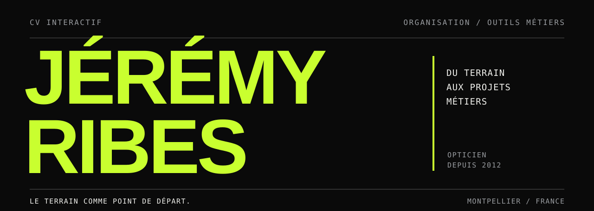

# Jérémy Ribes

**Opticien depuis 2012, ancien responsable de magasin, concepteur d’outils métiers.**

J’ai travaillé sur l’organisation des magasins, les méthodes de suivi et les outils utilisés par les équipes. Aujourd’hui, je cherche à évoluer vers la **coordination opérationnelle, l’amélioration des méthodes ou les projets d’outils métiers**, dans l’optique ou dans un autre secteur.

**[Consulter mon CV interactif](https://j-rbs91.github.io/CV_interactif_Jeremy_Ribes/)** · Le parcours, les réalisations, les expériences et les versions à imprimer sont accessibles depuis le site.

---

## Du terrain aux outils

Je fais le lien entre les objectifs de la direction et les contraintes de terrain. Quand une tâche se répète, qu’un dossier se perd ou qu’une information est saisie plusieurs fois, j’examine d’abord la façon de travailler. Selon le problème, je revois la procédure, la répartition des responsabilités ou l’outil.

Le développement fait partie des moyens que j’utilise. Mon point de départ reste le fonctionnement du magasin et les personnes qui utilisent ces outils.

## Quelques réalisations

### 01 / Hub Outils Opticien

Une interface qui rassemble plusieurs tâches quotidiennes : documents destinés aux médecins, clôture de caisse, calculs d’épaisseur et de décentrement. Les informations du magasin sont renseignées une seule fois. **Le hub est utilisé chaque jour par l’équipe.**

[Voir le Hub Outils Opticien](https://j-rbs91.github.io/Hub_Tools_N_Templates/)

### 02 / Suivi des devis et Brief’Maker

Deux outils conçus pour que les dossiers à reprendre, les prochaines actions, les rendez-vous et les tâches attribuées soient visibles par toute l’équipe. Créés dans une enseigne, ils sont aujourd’hui utilisés dans une autre.

### 03 / PANUM

Une application de suivi commercial pensée pour les magasins d’optique : dossiers centralisés, relances priorisées, historique des blocages et indicateurs de pilotage. **Le déploiement pilote reste à valider sur des données réelles.**

[Voir le projet PANUM](https://panum.fr/)

### 04 / Réorganisation d’un magasin

Comme responsable chez Générale d’Optique, j’ai travaillé sur le recrutement, la formation, les plannings, les procédures et l’activité commerciale. Sur les deux mois suivant ces actions, le magasin a enregistré **+83 % de chiffre d’affaires et +5,6 points de marge** par rapport à la moyenne des seize mois précédents. Ces résultats reflètent plusieurs actions menées ensemble, pas l’effet d’un seul outil.

### 05 / L’Ortabels

Un projet maraîcher accompagné d’une application d’aide à la décision. Elle exploite notamment les températures locales et les degrés-jours pour aider à organiser semis, développement des cultures et récoltes.

[Voir L’Ortabels](https://app.ortabels.fr/)

---

## À propos de ce dépôt

Ce dépôt contient le CV interactif. Le site est développé en **HTML, CSS et JavaScript natifs**, sans framework ni dépendance d’exécution. Il présente le parcours sur une page, avec des fiches détaillées et deux formats d’impression : un CV A4 d’une page et une présentation complète.

Structure et vérifications techniques

Les contenus du CV sont définis dans `js/data/`. Le rendu est assuré par `js/render/`, et l’identité visuelle actuelle de la page se trouve principalement dans `css/site.css`. Les choix de couleurs et de typographie sont documentés dans `docs/charte-couleurs.md` et `docs/charte-typographique.md`.

Après modification des données, `npm run build` régénère le contenu intégral de `index.html` pour les lecteurs qui n’exécutent pas JavaScript. `npm run verify` en contrôle la synchronisation. Les contrôles complémentaires sont `npm run check:nav`, `npm run check:cv` et `npm run check:typo` ; les deux derniers nécessitent un environnement de rendu navigateur et l’accès aux polices.

La publication du site est assurée par GitHub Pages.

Pour me joindre, utilise le formulaire de contact disponible sur le **[CV interactif](https://j-rbs91.github.io/CV_interactif_Jeremy_Ribes/)**.
